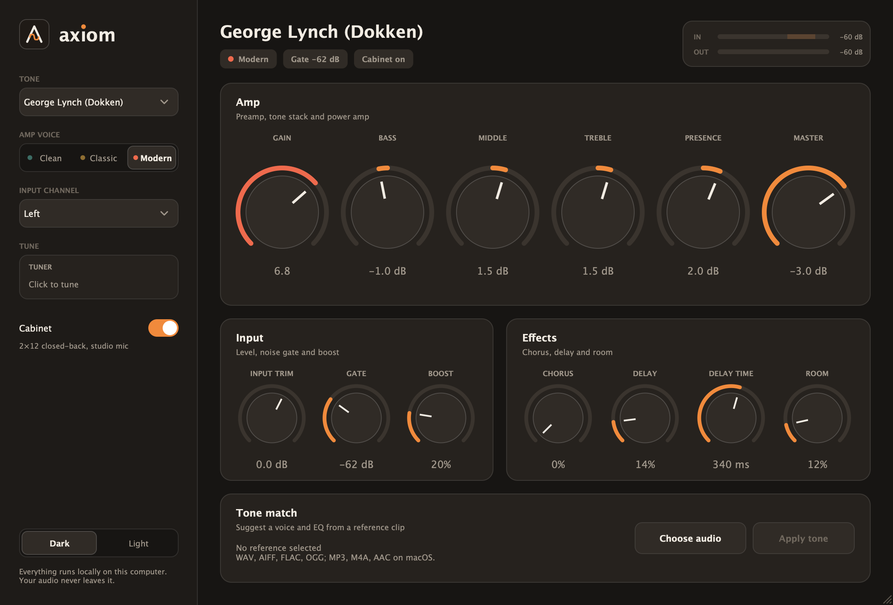
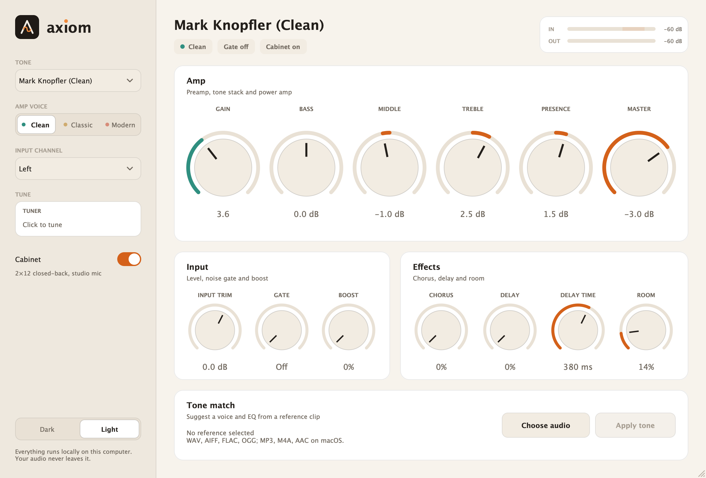

<div align="center">


# Axiom

**Find a guitar tone that feels like yours.**

A modern guitar amplifier for your Mac, as a standalone app or a VST3 / Audio Unit plugin.<br/>
Shape your sound by hand, or analyze a short reference clip and start from a suggested amp voice and EQ.<br/>
Everything runs locally.

[](https://github.com/JonneNieminen/Axiom/actions/workflows/build.yml)
[](https://github.com/JonneNieminen/Axiom/releases/latest)
[](LICENSE)

<br/>


[](https://juce.com)
[](https://isocpp.org)


<br/>





</div>

## Features

- **Organic gain staging**: cascaded asymmetric tube-style stages with coupling filters, power-amp sag and 8× oversampling, so overdrive stays smooth, dynamic and free of digital fizz. It cleans up when you roll your guitar volume down.
- **Three amp voices**: Clean (glassy, lots of headroom), Classic (plexi-style crunch) and Modern (tight, hot-rodded high gain).
- **Your own tones**: save the current sound from the preset menu and it is there in every session, standalone or in your DAW.
- **Tone presets**: George Lynch, Van Halen, David Gilmour, Mark Knopfler (clean and Les Paul distorted) and a huge 80s chorus clean. Every control stays adjustable.
- **Four-band tone section**, input trim, gain and master level, plus a mid-focused **Boost** in front of the amp. Tone knobs glide instead of stepping, so automating them never zips.
- **Noise gate** in front of the amp that silences hum and hiss between notes without chopping decaying notes. The high-gain presets turn it on.
- **Input and output meters**, with a marked sweet spot for setting Input trim.
- **Dark and light interface** in the Ember palette; each amp voice has its own colour. The theme is saved with your session.
- **Tuner** in the sidebar: click it, play a string, and it shows the note and how many cents you are off. The output mutes while you tune.
- **Built-in cabinet**: a 2×12-style speaker response you can switch off.
- **Effects**: stereo chorus, a darkening stereo delay and a small room reverb.
- **Tone Match**: analyze a short reference recording and apply a suggested voice, gain and EQ. The file never leaves your computer.
- **Standalone app and plugins**: a desktop amp with its own audio-interface settings, plus VST3 and Audio Unit for your DAW.
- **Mono amp, stereo output**: pick Left, Right or both inputs; the amp plays through both ears, so a single-input interface sounds centred.

## Install

1. Download the latest **`Axiom-x.y.z-macos-arm64.dmg`** (Apple Silicon) or **`-x86_64.dmg`** (Intel) from [Releases](https://github.com/JonneNieminen/Axiom/releases/latest).
2. Open the `.dmg` and drag **Axiom** to Applications.
3. The app isn't notarized yet, so run this once in Terminal before the first launch:

```bash
xattr -dr com.apple.quarantine /Applications/Axiom.app
```

4. Open Axiom. Choose your audio interface with the **Options** menu and allow microphone access when macOS asks; that is your interface input.

You can also use **System Settings → Privacy & Security → Open Anyway** instead of the command.

### Plugins

Each release also has a plugins zip. Copy `Axiom.vst3` to `~/Library/Audio/Plug-Ins/VST3` or `Axiom.component` to `~/Library/Audio/Plug-Ins/Components`, run the same `xattr -dr com.apple.quarantine` command on the copies, then rescan plugins in your DAW and add Axiom to a guitar or audio track.

## Using Axiom

### Start from a preset

Choose a starting tone in **Tone Preset**. The label switches to *Custom* as soon as you move a control.

| Preset | Voice | Character |
|---|---|---|
| **George Lynch (Dokken)** | Modern | Tight, saturated hot-rodded Marshall with a touch of boost and delay. |
| **Van Halen** | Classic | Cranked plexi-style crunch, bright and full, with a light chorus and slap delay. |
| **David Gilmour** | Classic | Sustaining, singing lead with boost, long delay and a roomy reverb. |
| **Mark Knopfler (Clean)** | Clean | Glassy, compressed clean that breaks up when you dig in. |
| **Mark Knopfler (Les Paul Dist)** | Classic | Mid-forward, nasal crunch with a push from the boost. |
| **80s Clean (Huge Chorus)** | Clean | Pristine clean with a wide stereo chorus and ambience. |

Choose **Save current tone…** at the bottom of the same menu to keep your own sound; it appears under *Your tones* from then on. Your tones are small files in `~/Library/Audio/Presets/Axiom` (**Show presets folder** opens it), so you can back them up or share them. Saving never changes the Input (left/right) choice, since that belongs to your audio interface.

These tones are inspired by the amps, guitars and pedals behind each sound; they are starting points, not models of any specific rig or recording. Add a guitar-appropriate **Input trim** if your interface is quiet.

### Shape your tone

| Control | What it does |
|---|---|
| **Voice** | Choose Clean, Classic or Modern preamp response. |
| **Input trim** | Set the level hitting the preamp. |
| **Gate** | Noise gate threshold. Raise it until the hiss between notes disappears; lower it if note tails get cut. All the way down is off. |
| **Gain** | Move from clean response into saturation. |
| **Bass · Middle · Treble · Presence** | Balance the amp's low end, body, edge and upper harmonics. |
| **Master** | Set the output level after the amp and cabinet. |
| **Boost** | A mid-focused overdrive in front of the amp for lead tones. |
| **Chorus** | Stereo chorus after the cabinet. |
| **Delay · Delay time** | Darkening stereo delay, 40 ms to 1 s. |
| **Room** | Blend in a small stereo room reverb. |
| **Input** | Choose Left, Right or Left + Right as the guitar source. |
| **Cabinet Sim** | Engage the internal 2×12-style speaker response. |

Hover any control for a short explanation, and double-click a knob to reset it. Set **Input trim** so the **IN** meter peaks in its shaded zone (about −18 to −6 dB) when you play hard.

### Tune up

Click **Tuner** in the sidebar and play one open string. It shows the nearest note (A4 = 440 Hz) and a needle that turns green within 3 cents. The output is muted while the tuner is on; click it again to play.

### Match a reference

1. Choose a short guitar recording in **Tone Match**. Axiom reads WAV, AIFF, FLAC or OGG locally (plus MP3, M4A and AAC through Core Audio) and analyzes up to 15 seconds.
2. Review the suggested tonal profile and amp voice.
3. Select **Apply tone** to update the voice, gain and EQ. Input trim, master, room and cabinet settings stay as they are.

Axiom estimates broad spectral balance and signal dynamics; it does not recreate a specific amp, guitar, pickup, cabinet or microphone chain. Treat the result as a starting point and finish the sound with the controls. See [`docs/TONE_MATCH.md`](docs/TONE_MATCH.md) for how the analysis works.

### Standalone tips

- Use headphones or keep the input muted until you are ready: the standalone app mutes the input by default to avoid feedback. Unmute it from the banner or **Options → Audio/MIDI Settings**.
- Pick a small buffer size (64–128 samples) for low latency.

## Build from source

Requirements: macOS, CMake 3.22+, C++17, Xcode command line tools and JUCE 9.0.5 or newer.

```bash
git clone https://github.com/JonneNieminen/Axiom.git && cd Axiom
git clone --depth 1 --branch 9.0.5 https://github.com/juce-framework/JUCE.git third_party/JUCE
cmake -S . -B build -G "Unix Makefiles" -DCMAKE_BUILD_TYPE=Release -DCMAKE_OSX_ARCHITECTURES=arm64
cmake --build build --config Release --target Axiom_Standalone Axiom_VST3 Axiom_AU -j 4
```

Products appear under `build/Axiom_artefacts/Release/`. Use `x86_64` for Intel or `arm64;x86_64` for a universal binary, add `-DJUCE_DIR=/path/to/JUCE` if JUCE lives elsewhere, or use `-G Xcode` to generate an Xcode project. Open the folder in VS Code with the recommended CMake Tools extension to build from the editor.

Run the DSP checks with `-DAXIOM_BUILD_TOOLS=ON`, then `cmake --build build --target AxiomRender` and `build/AxiomRender_artefacts/Release/AxiomRender [wav-output-dir]`. It renders every preset through a synthetic pluck, reports level, spectral balance, aliasing and THD, checks the noise gate and the tuner, and optionally writes WAV files. `build/AxiomSnapshot_artefacts/Release/AxiomSnapshot docs/screenshots/axiom-dark.png 1` renders the interface to a PNG without a host (add a preset number, then `tuner`, `save` or `light`); it is how the README screenshots are made. `AxiomMatch` compares Axiom with reference recordings and, on your own machine, any installed Audio Unit you own, as a measuring yardstick (`AxiomMatch analyze|render|au|diff`). `AxiomSnapshot --check` tests user presets and session state.

Build the drag-to-install DMG with `build/macos/make-dmg.sh build/Axiom_artefacts/Release/Standalone/Axiom.app 1.0.0 arm64 dist`.

CI ([`build.yml`](.github/workflows/build.yml)) builds all three targets for Apple Silicon and Intel on every push and pull request. [`release.yml`](.github/workflows/release.yml) publishes DMGs and plugin zips.

## Architecture

```
Host / audio device ──▶ AxiomAudioProcessor ──▶ AxiomDsp ──▶ stereo output
   input select → trim → drive → [8× oversampled: boost → tube stages → tone stack
   → power amp + sag → presence] → cabinet → master → chorus → delay → room

AxiomAudioProcessorEditor ──▶ parameters (AudioProcessorValueTreeState)
        └─ Tone Match: worker thread → FFT analysis → suggestion → Apply tone
```

| Path | What's there |
|---|---|
| [`Source/AxiomDsp.*`](Source/AxiomDsp.cpp) | The signal path: oversampled amp, cabinet, chorus, delay and room. Real-time safe. |
| [`Source/Presets.h`](Source/Presets.h) | Factory tone presets. |
| [`Source/PluginProcessor.*`](Source/PluginProcessor.cpp) | Host parameters, presets as programs and state. |
| [`tools/render`](tools/render/Main.cpp) | `axiom-render`: offline level, balance, aliasing and sample-rate checks. |
| [`Source/PluginEditor.*`](Source/PluginEditor.cpp) | Interface, reference-file chooser, analysis job and apply action. |
| [`Source/ToneMatchAnalyzer.*`](Source/ToneMatchAnalyzer.cpp) | Local spectral-profile analysis of a reference clip. |
| [`Source/DesignTokens.h`](Source/DesignTokens.h) | The Ember palette (dark and light) and the logo geometry. |
| [`design/`](design) | Logo masters (`make.py`) and the palette as CSS. |
| [`build/macos/`](build/macos) | DMG packaging script and install notes. |
| [`assets/`](assets) · [`docs/`](docs) | Logo marks, screenshots, design notes and Tone Match behavior. |

Parameter IDs are stable so saved DAW sessions keep working.

## Privacy

No network access, accounts or telemetry. Reference files are read locally for analysis and are never uploaded, stored in plugin state or embedded in your project.

## Contributing

Issues and pull requests are welcome; see [CONTRIBUTING.md](CONTRIBUTING.md).

## License

Axiom is [MIT](LICENSE) licensed. It is built with [JUCE](https://juce.com), which is available under the AGPLv3 or a commercial license; check JUCE's terms before distributing your own builds.
